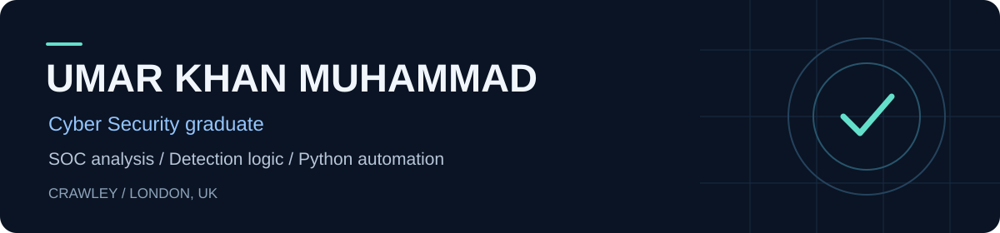

  <a href="https://khanu123.github.io/"><strong>Portfolio</strong></a> &nbsp; · &nbsp;
  <a href="https://khanu123.github.io/assets/Umar_Khan_Cyber_Security_CV_Updated.pdf"><strong>Download CV</strong></a> &nbsp; · &nbsp;
  <a href="https://www.linkedin.com/in/umar-khan-muhammad-0200b524a/"><strong>LinkedIn</strong></a> &nbsp; · &nbsp;
  <a href="mailto:Umargreat2004@gmail.com"><strong>Email</strong></a>

## About me

I'm a **Cyber Security graduate (BSc, 2:1, Anglia Ruskin University)** with penetration-testing training contract experience. I build Python tools and detection labs to explore how security alerts become investigations and reports.

**Seeking junior SOC / Cyber Security Analyst opportunities** in Crawley and London. UK settled status; no sponsorship required.

## Selected projects

| Project | What to review |
| :--- | :--- |
| **[Sentinel SOC Dashboard](https://github.com/Khanu123/sentinel-soc-dashboard)** | Alert triage, 30-minute correlation windows, ATT&CK context, and exportable reports. Start with the [investigation exercise](https://github.com/Khanu123/sentinel-soc-dashboard/blob/main/docs/validation/investigation.md). |
| **[Splunk Detection Lab](https://github.com/Khanu123/splunk-detection-lab)** | SPL searches for brute force, password spraying, and unusual privileged logins. Includes synthetic logs, Python validation, and an [analyst playbook](https://github.com/Khanu123/splunk-detection-lab/blob/main/docs/analyst-playbook.md). |
| **[Insider Threat Detection](https://github.com/Khanu123/insider-threat-detection-final-project)** | University project exploring behavioural anomalies with Isolation Forest and Random Forest. Review the [sample analyst report](https://github.com/Khanu123/insider-threat-detection-final-project/blob/main/docs/SAMPLE_ANALYST_REPORT.md) and documented limitations. |

## A closer look: investigating a false positive

The SOC dashboard exercise starts with an approved scanner receiving **priority 100**. Checking the authored ticket's source, scope, and timing changes the exercise conclusion to authorised activity. The score remains high, exposing a limitation that requires analyst judgement.

The same exercise exposed alerts being merged across different days. The revised implementation uses bounded correlation windows and keeps incomplete identities separate.

**1,014-alert regression exercise · 3 investigation scenarios · 34 unit tests**

[Read the investigation](https://github.com/Khanu123/sentinel-soc-dashboard/blob/main/docs/validation/investigation.md) · [Inspect the results](https://github.com/Khanu123/sentinel-soc-dashboard/blob/main/docs/validation/extended-results.json) · [View CI](https://github.com/Khanu123/sentinel-soc-dashboard/actions)

> These are reproducible synthetic lab results, not operational detection accuracy. Live Splunk and Microsoft Sentinel query validation remains pending. The public insider-threat project uses a small sanitised sample.

**Input quality:** strict row validation, exact-event deduplication, and explicit partial-load diagnostics. The scenario fixture accounts for all 15 rows: 11 accepted alerts, one duplicate, and three rejected rows.

[Follow the walkthrough](https://khanu123.github.io/investigations.html) · [Review the input-handling tests](https://github.com/Khanu123/sentinel-soc-dashboard/blob/main/tests/test_ingestion.py)

## Technical focus

| Skill | Evidence |
| :--- | :--- |
| Investigation and false-positive review | [Three contrasting cases](https://github.com/Khanu123/sentinel-soc-dashboard/blob/main/docs/validation/walkthrough.md) |
| Python input handling and testing | [Validation module](https://github.com/Khanu123/sentinel-soc-dashboard/blob/main/src/sentinel_soc_dashboard/ingestion.py) · [34-test suite](https://github.com/Khanu123/sentinel-soc-dashboard/blob/main/tests) |
| Correlation and reporting | [30-minute grouping and HTML escaping](https://github.com/Khanu123/sentinel-soc-dashboard/blob/main/src/sentinel_soc_dashboard/core.py) |
| Detection logic | [SPL searches](https://github.com/Khanu123/splunk-detection-lab/tree/main/spl) · [KQL queries](https://github.com/Khanu123/microsoft-sentinel-siem-lab/tree/main/kql) |
| Reproducible setup | [Clean-install walkthrough](https://github.com/Khanu123/sentinel-soc-dashboard/blob/main/docs/validation/walkthrough.md) |

<strong>More projects — cloud security, DevOps, and analysis tools</strong>

 

- **[DevOps Deployment Lab](https://github.com/Khanu123/devops-deployment-lab):** containerised SOC service, Terraform AWS infrastructure, CI, and recovery drills. Local/CI evidence is available; live AWS deployment is pending.
- **[Microsoft Sentinel SIEM Lab](https://github.com/Khanu123/microsoft-sentinel-siem-lab):** KQL source, sample events, and triage notes.
- **[Azure Security Posture Reviewer](https://github.com/Khanu123/azure-security-posture-reviewer):** configuration checks and remediation guidance.
- **[Cloud IAM Risk Analyzer](https://github.com/Khanu123/cloud-iam-risk-analyzer):** policy analysis and least-privilege review.
- **[Phishing Email Analyzer](https://github.com/Khanu123/phishing-email-analyzer):** email headers, suspicious URLs, and risk indicators.
- **[Vulnerability Intelligence Prioritizer](https://github.com/Khanu123/vuln-intel-prioritizer):** vulnerability prioritisation and remediation targets.
- **[Web Security Posture Auditor](https://github.com/Khanu123/web-security-posture-auditor):** HTTPS and security-header checks.
- **[Security Research Notes](https://github.com/Khanu123/security-research-notes):** defensive security learning notes.

<strong>Professional certificates and additional learning</strong>

 

- [Google Cybersecurity Professional Certificate](https://coursera.org/verify/professional-cert/MGEFGHD22PJS)
- [Microsoft Cybersecurity Analyst Professional Certificate](https://coursera.org/verify/professional-cert/TRVDNZ7C85RY)

**Short courses and guided projects**

[CompTIA a+ Cyber — Coursera course](https://coursera.org/verify/FBFGGP5VB2VV) · [Windows Defender and Firewall](https://coursera.org/verify/H8GM57R87CVS) · [Wireshark packet capture](https://coursera.org/verify/EDULQYP9DFE7) · [TCPDump traffic analysis](https://coursera.org/verify/UFBWZA5WMYJU)

Additional Forage simulations cover phishing, risk assessment, and IAM.

---

**Next:** document live SIEM query execution, test against richer telemetry, and validate the cloud deployment.
